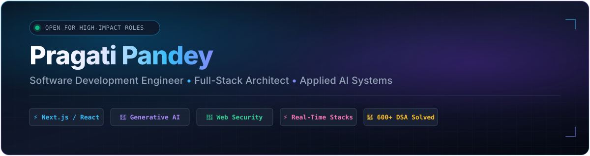

<div align="center">

<a href="https://pragati-pandey-portfolio.vercel.app">
  
</a>

<br/><br/>

<a href="https://pragati-pandey-portfolio.vercel.app">
  
</a>

<br/>

<p align="center">
  <a href="https://komarev.com/ghpvc/?username=pragatipandey25&label=PROFILE+VIEWS&color=0284c7&style=for-the-badge">
    
  </a>
  <a href="https://github.com/pragatipandey25?tab=followers">
    
  </a>
  <a href="https://github.com/pragatipandey25?tab=repositories">
    
  </a>
  <a href="https://leetcode.com/u/pragatii_pandey/">
    
  </a>
  <a href="https://www.hackerrank.com/profile/pragatipandey454">
    
  </a>
</p>

</div>

---

### 🌐 Connect & Collaborate

<p align="center">
  <a href="https://pragati-pandey-portfolio.vercel.app" target="_blank">
    
  </a>
  &nbsp;
  <a href="https://linkedin.com/in/pragati-pandey-25f2006" target="_blank">
    
  </a>
  &nbsp;
  <a href="https://leetcode.com/u/pragatii_pandey/" target="_blank">
    
  </a>
  &nbsp;
  <a href="https://github.com/pragatipandey25" target="_blank">
    
  </a>
  &nbsp;
  <a href="mailto:pragatipandey454@gmail.com" target="_blank">
    
  </a>
  &nbsp;
  <a href="https://www.instagram.com/pragatii_pandey/" target="_blank">
    
  </a>
</p>

---

### ⚡ Executive Profile

```typescript
interface SoftwareEngineer {
  name: string;
  role: string;
  coreStack: string[];
  domains: string[];
  problemSolving: string;
  currentFocus: string;
}

const pragati: SoftwareEngineer = {
  name: "Pragati Pandey",
  role: "Software Development Engineer (SDE)",
  coreStack: ["Next.js 15", "React 19", "TypeScript", "Node.js", "Express", "MongoDB Atlas"],
  domains: ["Full-Stack Distributed Systems", "Applied Generative AI", "Web Application Security"],
  problemSolving: "600+ LeetCode Solutions | 5★ Ratings across 5 HackerRank Tracks",
  currentFocus: "Architecting scalable cloud microservices, voice AI interfaces, and security auditing tools"
};
```

---

### 🚀 Core Engineering Pillars

<table>
  <tr>
    <td width="50%" valign="top">
      <h4>💻 Modern Full-Stack Systems</h4>
      <ul>
        <li>Architecting production-ready applications with <b>Next.js App Router, React, Node.js, and TypeScript</b>.</li>
        <li>Specialized in component design systems, state machines, and performant RESTful APIs.</li>
        <li>Engineering low-latency bidirectional messaging via <b>WebSockets (Socket.io)</b> and <b>Stream Video SDK</b>.</li>
      </ul>
    </td>
    <td width="50%" valign="top">
      <h4>🤖 Applied AI & Intelligent Orchestration</h4>
      <ul>
        <li>Deep integration with <b>Google Gemini AI</b> for structured extraction, reasoning, and automated scoring.</li>
        <li>Pioneered real-time voice streaming with the <b>Web Audio API</b> for conversational mock interviews.</li>
        <li>Client-side legal and PDF parsing pipelines with bilingual (EN/HI) intelligence.</li>
      </ul>
    </td>
  </tr>
  <tr>
    <td width="50%" valign="top">
      <h4>🔐 Web Security & System Hardening</h4>
      <ul>
        <li>Vulnerability assessment engines scanning for <b>OWASP Top 10</b> security flaws.</li>
        <li>HTTP security header analysis (<b>CSP, HSTS, X-Frame-Options</b>) and guided developer remediation.</li>
        <li>Robust authentication architecture incorporating <b>JWT, HTTP-only cookies, and Clerk Auth</b>.</li>
      </ul>
    </td>
    <td width="50%" valign="top">
      <h4>🧠 Algorithmic Rigor & CS Foundations</h4>
      <ul>
        <li><b>600+ solved algorithmic problems on LeetCode</b> with deep focus on graphs, DP, and optimization.</li>
        <li><b>5★ Gold Badges in 5 languages</b> on HackerRank (C++, Java, Python, C, Problem Solving).</li>
        <li>Strong fundamentals in <b>DSA, OOP, DBMS, Operating Systems, Computer Networks, and System Design</b>.</li>
      </ul>
    </td>
  </tr>
</table>

---

### 🌟 Featured Flagship Projects

<div align="center">

| Project | Category | Direct Links | Architectural Highlights | Tech Stack |
|:---|:---:|:---:|:---|:---|
| ⚖️ **LexiAI** | `AI / ML` | [🌐 Live App](https://lexi-ai-red.vercel.app/) • [💻 Repo](https://github.com/pragatipandey25/Lexi-AI) | AI-powered legal document assistant with smart contract parsing, clause liability detection, risk flagging, and bilingual (English/Hindi) Q&A. | `React` `Google Gemini AI` `Tailwind CSS` `PDF.js` `TypeScript` |
| 🎙️ **IntervixAI** | `AI / ML` | [🌐 Live App](https://intervix-ai.vercel.app/) | Real-time AI voice interview platform simulating technical rounds with adaptive question synthesis, voice streaming, and granular scoring. | `Next.js` `Web Audio API` `Google Gemini AI` `TypeScript` `Tailwind` |
| 🛡️ **TraceGuard** | `Cybersecurity` | [🌐 Live App](https://traceguard-red.vercel.app/) | Web security assessment platform that scans web applications for vulnerabilities, audits HTTP headers (CSP, HSTS), and guides fixes. | `React` `TypeScript` `Node.js` `OWASP` `Tailwind CSS` |
| 🏭 **Apex ERP** | `Full Stack` | [🌐 Live App](https://apex-erp-blond.vercel.app/) | Enterprise manufacturing ERP with live inventory tracking, automated Bill of Materials (BOM) logic, and multi-tier role-based access. | `Next.js App Router` `Tailwind CSS` `TypeScript` `Node.js` `State Machines` |
| 📄 **HireSense** | `AI / ML` | [🌐 Live App](https://hire-sense-six.vercel.app/) | AI recruitment intelligence system parsing resumes, calculating ATS match scores, detecting skill gaps, and ranking applicants. | `React` `Node.js` `Express` `Google Gemini AI` `Tailwind CSS` |

</div>

<br/>

<details>
<summary><b>⚡ View Additional Production & Real-Time Applications (5 More)</b></summary>
<br/>

- 💬 **[BlinkTalk](https://blinktalk-2kro.onrender.com/)** — Full-stack real-time messaging application with sub-100ms WebSocket delivery, JWT authentication, and live presence tracking. *(MERN • Socket.io • Zustand • Tailwind CSS)*
- 🎥 **[MeetFlow](https://meet-flow-sigma.vercel.app/)** — HD video conferencing suite featuring scheduled meetings, personal room links, and low-latency screen sharing. *(Next.js • Stream Video SDK • Clerk Auth • Tailwind CSS)*
- 🎬 **[Streamify](https://streamify-chi-blue.vercel.app/)** — High-performance video streaming web app with cloud media ingestion, custom HTML5 playback controls, and categorized feeds. *(React • Node.js • Express • MongoDB • Tailwind CSS)*
- 🍳 **[TasteNest](https://taste-nest-jet.vercel.app/)** — Responsive recipe discovery application with multi-parameter ingredient filtering, measurement checklists, and YouTube guides. *(React • TypeScript • Tailwind CSS • TheMealDB API)*
- 📝 **[Quiz App](https://quiz-app-flame-xi.vercel.app/)** — Interactive engineering assessment portal with subject-specific question pools, real-time countdown timer, and performance analytics. *(React • TypeScript • Tailwind CSS)*

</details>

---

### 🛠️ Tech Stack & Technical Arsenal

<div align="center">

#### 💻 Programming Languages
<p align="center">
  
</p>

#### 🎨 Frontend & User Interface Architecture
<p align="center">
  
</p>

#### ⚙️ Backend, Microservices & Real-Time Engines
<p align="center">
  
</p>

#### 🗄️ Database, Storage & Cloud Deployment
<p align="center">
  
</p>

#### 🤖 Applied AI, Systems Security & Specialized Tooling
<p align="center">
  
  &nbsp;
  
  &nbsp;
  
  &nbsp;
  
  &nbsp;
  
  &nbsp;
  
  &nbsp;
  
</p>

#### 🛠️ Developer Tools & DevOps
<p align="center">
  
</p>

</div>

---

### 📊 GitHub & Coding Analytics

<div align="center">

<table border="0">
  <tr>
    <td width="50%" align="center">
      
    </td>
    <td width="50%" align="center">
      
    </td>
  </tr>
</table>

<br/>


<br/><br/>

<a href="https://leetcode.com/u/pragatii_pandey/">
  
</a>

</div>

---

### 💡 Engineering Philosophy

```cpp
while (curiosity && dedication) {
    Analyze();
    Architect();
    Implement();
    Profile();
    Optimize();
    Deliver();
}
```

---

<div align="center">

### ✨ Let's Build Something Exceptional

*"Building intelligent software, solving real-world challenges, and continuously pushing the boundaries of technology."*

<br/>

<a href="https://pragati-pandey-portfolio.vercel.app" target="_blank">
  
</a>
&nbsp;
<a href="mailto:pragatipandey454@gmail.com" target="_blank">
  
</a>

<br/><br/>

⭐ **Star my repositories if you find my open-source work inspiring!**

</div>
